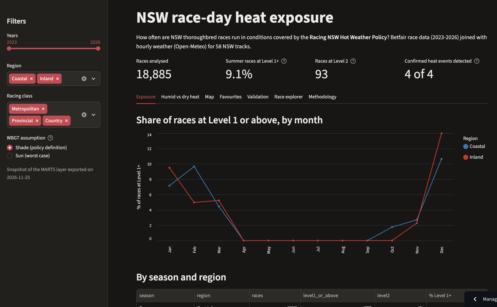
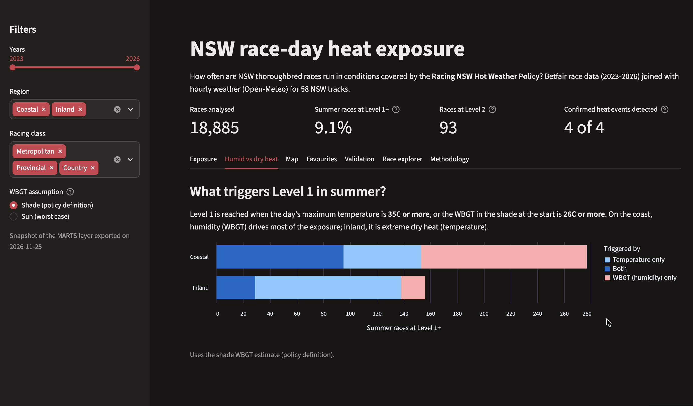
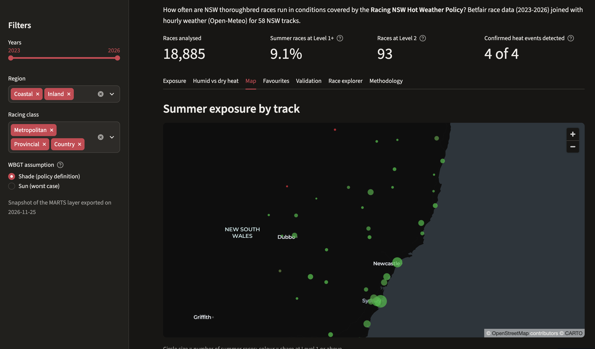
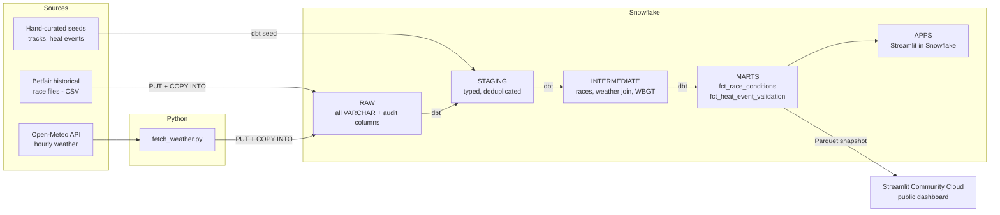

# Race Heat Welfare: NSW race-day heat exposure

**How often are NSW thoroughbred races run in conditions covered by the Racing NSW Hot Weather Policy, and what drives that exposure?**

An end-to-end data pipeline that joins Betfair race results with hourly weather for 58 NSW tracks, estimates heat stress (WBGT) at every race start, and classifies each race against the official policy levels.

**[Live dashboard →](https://race-heat-welfare.streamlit.app/)**



**Stack:** Python · Snowflake (DCM Projects, Streamlit in Snowflake) · dbt v2 · Streamlit · GitHub

---

## Why this project

I'm a veterinarian (University of Buenos Aires) who has worked with thoroughbreds in Australia and as a data engineer. Heat stress is a real welfare risk for racehorses. Horses shed most of the heat of exercise by sweating, which only cools them if the sweat can evaporate, so humid heat can be more dangerous than dry heat at a higher temperature. Racing NSW manages this with a two-level Hot Weather Policy. This project measures, with public data, how often races fall under it and why.

## Key findings

Data covers **18,885 NSW races** from January 2023 to October 2026.

1. **About 9% of summer races reach Level 1 or above**, on the coast (9.1%) and inland (9.2%) alike. Around **2% of summer races reach Level 2**. Winter exposure is zero.
2. **The coast and inland face different kinds of heat.**
   - On the coast, humidity drives the exposure. 124 of the 277 coastal summer races at Level 1+ are flagged *only* by WBGT, on days that never reach 35°C. A temperature-only rule would miss **45%** of them.
   - Inland, it is extreme dry heat: temperature triggers 138 of 156 at-risk races.

   

3. **The result is highly sensitive to one physical assumption.** Estimating WBGT in the sun instead of the shade (the policy's definition) raises coastal summer exposure from **9% to 57%**. The pipeline uses the shade estimate and keeps the sun estimate as a documented sensitivity check.
4. **Validation against real decisions.** All **4 of 4** dated, confirmed heat measures by Racing NSW fall at Level 2 according to this data. They are:
   - Parkes, December 2023: meeting postponed.
   - Wagga, January 2026: meeting transferred.
   - Wyong, January 2026: start brought forward to 11:05am, which is visible in the data.
   - Kembla Grange, January 2026: 41°C forecast.

   Our daily maximums are within about 2°C of the official forecasts.
5. **Favourites and heat: no significant effect.** In normal conditions favourites beat the market's expectation by +1.1 pp (±0.7, significant), the well-known favourite-longshot bias. On Level 1 and Level 2 days that edge disappears. With only 468 and 93 such races, though, the difference is well inside the margin of error.



## Architecture



| Layer | Managed by | Contents |
|---|---|---|
| Infrastructure | **DCM Projects** (declarative) | Databases, schemas, warehouses, roles and grants for DEV and PROD from the same definitions |
| RAW | Snowflake CLI (`PUT` + `COPY INTO`) | Source files as received, every column as VARCHAR, plus source file, row and load timestamp |
| STAGING | dbt (views) | Type casting, mixed date/time format parsing, deduplication |
| INTERMEDIATE | dbt (views) | One row per race, start time in UTC, weather at the nearest hour, wet-bulb and WBGT estimates |
| MARTS | dbt (tables) | Analysis-ready race facts with policy level, plus the validation table |
| APPS | Snowflake CLI | Streamlit in Snowflake dashboard reading the marts live |

## Design decisions

- **Infrastructure as code with DCM Projects.** Every object is declared with `DEFINE` statements and templated per environment (`{{env}}`). Changes go through `snow dcm plan`, which lists exactly what will be created, altered or dropped, before `snow dcm deploy`. Re-running the plan with no changes returns zero changes.
- **Least-privilege roles.** `RACING_DEPLOYER` owns and changes infrastructure. `RACING_<ENV>_ENGINEER` loads data and runs dbt, and cannot drop or create infrastructure. Both roll up to `SYSADMIN`. An account-level resource monitor caps monthly credits.
- **RAW is all VARCHAR.** Loads never fail on an unexpected format, and every parsing rule lives in dbt, where it is tested.
- **Policy thresholds as dbt vars.** Level 1 is 35°C or a WBGT in the shade of 26°C. Level 2 is 38°C or a WBGT in the shade of 28°C. If the policy changes, one file changes.
- **WBGT in the shade:** 0.7 × wet-bulb temperature (Stull, 2011) + 0.3 × air temperature, matching the policy's "WBGT shade". The Bureau of Meteorology sun approximation is kept as a worst case.
- **One dashboard, two deployments.** The same code reads the marts live inside Streamlit in Snowflake, and a Parquet snapshot on Streamlit Community Cloud. The public version keeps working after the Snowflake trial ends.
- **dbt v2.** dbt v2 is the current major version and is supported by dbt Projects on Snowflake.

## Data quality findings

Every finding below is handled in code and covered by a dbt test:

| Finding | How it was handled |
|---|---|
| A race with every runner duplicated three times | Deduplicated in STAGING (`QUALIFY ROW_NUMBER()`), protected by a `unique` test |
| Three date/time formats across files (one file likely edited in Excel: `1/04/2025`, `12:43:00 PM`) | `coalesce(try_to_date(...), ...)` in STAGING, with `not_null` tests that fail on any new format |
| Race times not documented as local or Sydney time | Inferred from the data: WA races appear about 2.8 h later than NSW in summer and 2.4 h in winter, and NZ races about 3 h earlier. So all times are Sydney time. Confirmed against a Racing NSW race-day preview, where start times match to the minute |
| 125 races with two winners (0.17%) | Legitimate dead heats. The test asserts "at least one winner per race" instead of "exactly one" |
| A new track name (Illawarra Grange) from May 2026 | Researched: it is the new B track at Kembla Grange, so it was mapped to the same coordinates |
| 4 of 6 heat events with an inferred year (news items rarely state it) | Verified against Betfair meetings and weather. All 4 failed and were discarded |

## Limitations

- **WBGT is estimated, not measured.** It comes from gridded reanalysis data (ERA5, about 10 km), not on-course instruments, and ignores local shade, wind and surface. Treat it as an indicator.
- **Forecast versus observed.** Racing NSW acts on forecast maximums, while this pipeline uses observed reanalysis values.
- **The heat-event list used for validation is incomplete**, so it is a case study, not a detection rate. One event (Ballina, 9 January 2026) remains unexplained: race times changed, but our data shows only 28°C.
- **Scratchings are not in the Betfair data.** Gaps in TAB numbers are kept only as an approximate proxy.
- **Track regions (coastal or inland) and coordinates are hand-curated approximations.**

## Repository structure

```
race-heat-welfare/
├── scripts/                  # Python: weather download, track seed helper, dashboard snapshot export
├── snowflake/
│   ├── bootstrap/            # one-off setup (deployer role, admin DB, resource monitor)
│   ├── dcm/                  # DCM Project: manifest + declarative definitions (DEV/PROD)
│   └── load/                 # PUT + COPY INTO into RAW
├── dbt/
│   ├── models/               # staging / intermediate / marts
│   ├── seeds/                # tracks, hot-weather events (with source URLs)
│   ├── macros/               # wet-bulb and WBGT estimates, schema naming
│   ├── tests/                # singular tests
│   └── analyses/             # reproducible queries behind the findings
├── dashboard/                # Streamlit app (Snowflake + Community Cloud) and Parquet snapshot
└── docs/images/
```

## How to reproduce

**Prerequisites:** Python 3.12, a Snowflake account, Snowflake CLI 3.16+ and dbt v2.

```bash
# 1. Environment
python3.12 -m venv .venv && source .venv/bin/activate
python -m pip install -r requirements-dev.txt

# 2. Data (Betfair files go to data/raw/betfair/, downloaded manually)
python scripts/fetch_weather.py

# 3. Infrastructure (connection with ACCOUNTADMIN for the bootstrap, then RACING_DEPLOYER)
snow sql -f snowflake/bootstrap/00_bootstrap.sql
snow dcm create --target DEV --from snowflake/dcm
snow dcm plan   --target DEV --from snowflake/dcm
snow dcm deploy --target DEV --from snowflake/dcm
snow sql -f snowflake/bootstrap/01_post_deploy.sql -D "env=DEV"

# 4. Load RAW (connection with RACING_DEV_ENGINEER)
snow sql -c racing_dev -f snowflake/load/load_raw.sql -D "env=DEV" -D "project_dir=$(pwd)"

# 5. Transform and test (profile template in dbt/profiles.example.yml)
cd dbt && dbt build && cd ..

# 6. Dashboard
python scripts/export_dashboard_snapshot.py
streamlit run dashboard/streamlit_app.py
cd dashboard && snow streamlit deploy --replace -c racing_dev
```

## Roadmap

- [ ] CI/CD with GitHub Actions: `dbt build` and `snow dcm plan` on every pull request
- [ ] Automated monthly ingestion when Betfair publishes a new file
- [ ] Landing zone in S3 with a storage integration and Snowpipe auto-ingest
- [ ] PROD environment deployment
- [ ] Extract late scratchings and their reasons from stewards' reports with Snowflake Cortex AI

## Data sources and references

- Race data: [Betfair Data Scientists, historical ANZ thoroughbred files](https://betfair-datascientists.github.io/data/dataListing)
- Weather: [Open-Meteo historical weather API](https://open-meteo.com/) (ERA5 reanalysis)
- Policy: [Racing NSW, Racing in Hot Weather Policy](https://www.racingnsw.com.au/wp-content/uploads/2017/09/racing-in-hot-weather.pdf)
- Wet-bulb temperature: Stull, R. (2011). *Wet-Bulb Temperature from Relative Humidity and Air Temperature.* Journal of Applied Meteorology and Climatology, 50(11).
- Heat-event sources: listed row by row in `dbt/seeds/seed_hot_weather_events.csv`

## Author

**Gonzalo Velazquez**: veterinarian turned data and analytics engineer, based in NSW, Australia.
[LinkedIn](https://www.linkedin.com/in/gonzalojvelazquez/) · [GitHub](https://github.com/peladovelazquez)
